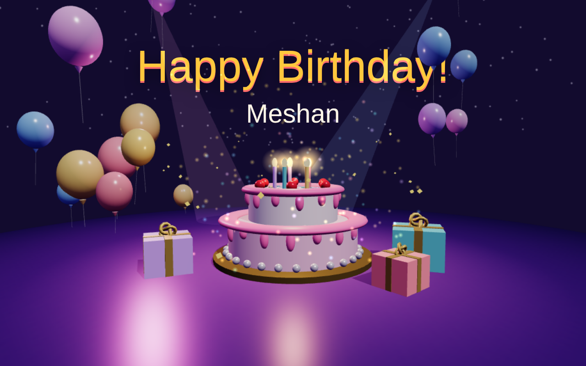

<div align="center">

# 🎂 3D Birthday Greeting

A 3D birthday scene in the browser: a cake with candles you can blow out, balloons you can pop, fireworks, and the name of your choice.

[](https://meshannawod.github.io/birthday-greeting-website/?name=Meshan)

   



</div>

**Make it personal:** add `?name=` to the link, for example [`…/birthday-greeting-website/?name=Alex`](https://meshannawod.github.io/birthday-greeting-website/?name=Alex).

---

## ✨ Features

* **Interactive 3D Scene:** Powered by Three.js with realistic lighting, shadows, tone mapping, and custom materials.
* **Personalized Greeting:** Easily change the recipient's name using a simple URL query parameter (e.g., `?name=Alex`).
* **Interactive Elements:**
  * **Click the Cake:** Toggle the candle flames on or off (triggers smoke/extinguish particles when turned off).
  * **Click Balloons:** Pop floating balloons to trigger particle bursts.
  * **Click Anywhere:** Spawns a mini-burst of festive sparkles.
* **Dynamic Performance Scaling:** Automatically adjusts the pixel ratio and quality factors based on device performance to maintain smooth frame rates.
* **Responsive Design:** Adapts seamlessly to various screen sizes and mobile safe areas.

---

## 🚀 Quick Start

Since this project is contained within a **single standalone HTML file**, running it is simple:

1. **Clone the repository:**
   ```bash
   git clone [https://github.com/your-username/your-repo-name.git](https://github.com/your-username/your-repo-name.git)

 * Open the file:
   * Double-click index.html to open it directly in your web browser.
   * Or use a local development server (such as the VS Code Live Server extension).
🎁 Personalization
To customize the birthday greeting for someone special, append the name parameter to the URL:
index.html?name=Sarah

🛠️ Tech Stack
 * HTML5 / CSS3: Modern styling with CSS variables, Google Fonts (Bagel Fat One and Fredoka), and keyframe animations.
 * JavaScript (ES6+): Vanilla script handling the animation loop, raycasting, math logic, and event listeners.
 * Three.js (r128): WebGL library utilized for 3D rendering, geometries, lighting, instanced meshes, and particle systems.
📄 License
This project is open-source and available under the MIT License. Feel free to use, modify, and share it to make someone's birthday special!

